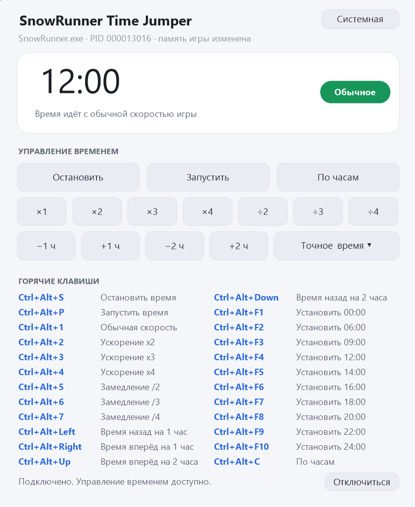

# SnowRunner Time Jumper

Небольшая программа для управления игровым временем в **SnowRunner**: остановка
и запуск часов, ускорение и замедление хода времени, сдвиг часов назад и
вперёд, установка точного времени и синхронизация с часами компьютера.

Программа написана с нуля на C (Win32 API), **не использует сетевых функций,
автозапуска и сторонних библиотек**; в реестр она только читает тему Windows.
Файлы, которые она создаёт, — журнал работы
`%LOCALAPPDATA%\SnowRunnerTimeJumper\srtc.log` и файл настроек темы
`settings.ini` там же.



## Быстрый старт

1. Скачать `SnowRunnerTimeJumper.exe` из [релизов](https://github.com/zhenyasreda/SnowRunnerTimeJumper/releases) и запустить **после** SnowRunner.
2. Программа сама найдёт игру и подключится; в окне появится текущее время игры.
3. Управлять временем горячими клавишами (`Ctrl+Alt+…`) или кнопками.

> Антивирус может ругаться на файл: программа изменяет память процесса игры —
> это и есть её назначение. Срабатывание ложное, файл можно добавить
> в исключения. Подробности — в разделе
> [«Передача другим людям»](#передача-другим-людям).

Собрать из исходников (MinGW-w64 или CMake) — в разделе
[«Сборка»](#сборка). Тесты — в разделе [«Автотесты»](#автотесты).

---

## Как это работает

Игра хранит текущее время в памяти. Программа находит в модуле `SnowRunner.exe`
инструкцию, которой игра обновляет часы:

```
F3 41 0F 11 95 <disp32>     movss dword ptr [r13+disp32], xmm2
```

и подменяет её переходом (JMP) на маленький **стаб** — 90 байт машинного кода,
который пишется в память игры ровно один раз.

Стаб умеет три вещи (режим хранится в блоке данных рядом с кодом):

| Режим | Поведение |
|---|---|
| Обычный | Выполняет исходную инструкку — время идёт как обычно. |
| Стоп | Ничего не пишет — часы стоят. |
| Фиксированное | Каждый кадр записывает в часы значение из блока данных. |

Стаб дополнительно сообщает программе **реальный адрес часов** и **«родное»
время игры**, поэтому программа показывает точное время, а не приближённое.

### Почему это надёжнее, чем в похожих программах

* Код в игре **не переписывается** во время работы. Все переключения режимов —
  это запись одного 32-битного числа в обычную область данных. Такая запись
  атомарна, поэтому игра не может выполнить «наполовину записанную»
  инструкцию (главная причина случайных вылетов в аналогичных программах).
* Смещение часов ищется **по маске**, а не по жёстко заданному числу, поэтому
  программа не сломается, если разработчики переставят счётчик часов.
* При подключении программа **проверяет** найденное место: если значение не
  похоже на часы — подхват берётся отменяется и ищется следующий кандидат.
* При выходе оригинальная инструкка возвращается на место, а выделенная
  память освобождается.
* Запрашиваются **минимальные права** на процесс (`VM_READ | VM_WRITE |
  VM_OPERATION | QUERY_INFORMATION`), а не `PROCESS_ALL_ACCESS`.
* Страница с кодом стаба закрывается на запись (`PAGE_EXECUTE_READ`).

---

## Горячие клавиши

Все сочетания начинаются с `Ctrl+Alt` — они не пересекаются ни с игровыми
клавишами (в SnowRunner `1`–`5` переключают вид камеры, `Ctrl` и `Shift`
отвечают за передачи), ни с привычными сочетаниями браузеров (`Ctrl+1…9`,
`Ctrl+«+»/«-»`).

| Действие | Клавиши |
|---|---|
| Остановить время | `Ctrl+Alt+S` |
| Запустить время (естественный ход игры) | `Ctrl+Alt+P` |
| Обычная скорость времени (×1) | `Ctrl+Alt+1` |
| Ускорение ×2 | `Ctrl+Alt+2` |
| Ускорение ×3 | `Ctrl+Alt+3` |
| Ускорение ×4 | `Ctrl+Alt+4` |
| Замедление ÷2 | `Ctrl+Alt+5` |
| Замедление ÷3 | `Ctrl+Alt+6` |
| Замедление ÷4 | `Ctrl+Alt+7` |
| Время вперёд на 1 час | `Ctrl+Alt+Right` |
| Время назад на 1 час | `Ctrl+Alt+Left` |
| Время вперёд на 2 часа | `Ctrl+Alt+Up` |
| Время назад на 2 часа | `Ctrl+Alt+Down` |
| Установить 00:00 | `Ctrl+Alt+F1` |
| Установить 06:00 | `Ctrl+Alt+F2` |
| Установить 09:00 | `Ctrl+Alt+F3` |
| Установить 12:00 | `Ctrl+Alt+F4` |
| Установить 14:00 | `Ctrl+Alt+F5` |
| Установить 16:00 | `Ctrl+Alt+F6` |
| Установить 18:00 | `Ctrl+Alt+F7` |
| Установить 20:00 | `Ctrl+Alt+F8` |
| Установить 22:00 | `Ctrl+Alt+F9` |
| Установить 24:00 | `Ctrl+Alt+F10` |
| Синхронизировать с реальными часами | `Ctrl+Alt+C` |

Сдвиг часов и установка точного времени **не останавливают течение времени**:
если часы шли, они продолжают идти (на обычной скорости, если до этого была
установлена другая скорость). Если часы были остановлены — они останутся
остановленными на новом значении.

Все действия доступны и мышью: кнопки в окне делают то же самое, что и
горячие клавиши, а кнопка «Точное время ▾» открывает список пресетов.

---

## Оформление

В правом верхнем углу окна есть кнопка переключения темы:

| Тема | Когда используется |
|---|---|
| **Системная** (по умолчанию) | Как в Windows: тёмная, если в Windows включён тёмный режим |
| **Светлая** | Всегда светлая |
| **Тёмная** | Всегда тёмная |

Выбор сохраняется в
`%LOCALAPPDATA%\SnowRunnerTimeJumper\settings.ini` и применяется при следующем
запуске. Если тема системная, программа сама подхватывает её изменение в
Windows.

---

## Сборка

Нужен любой из вариантов:

* **MSYS2 / MinGW-w64** (gcc, windres, mingw32-make);
* **Visual Studio 2022** с компонентой «Разработка классических приложений на C++»;
* **CMake** + gcc или cl.

### MinGW-w64

```bash
mingw32-make            # build/SnowRunnerTimeJumper.exe
mingw32-make test       # автотест машинного кода стаба
mingw32-make clean
```

### MSVC / CMake

```bash
cmake -S . -B build-cmake -DCMAKE_BUILD_TYPE=Release
cmake --build build-cmake --config Release
```

### Просто

Двойной клик по **`build.bat`** — скрипт сам найдёт компилятор.

Готовый файл: `build/SnowRunnerTimeJumper.exe` (один файл, ~130 КБ,
зависимостей нет, кроме системных библиотек Windows).

> На этой машине для проверки сборки был установлен MinGW-w64 в
> `C:\Users\sreda\AppData\Local\Temp\opencode\mingw\mingw64` (его можно
> удалить или использовать для дальнейшей сборки — добавьте `bin` в `PATH`).

---

## Использование

1. Запустите SnowRunner.
2. Запустите `SnowRunnerTimeJumper.exe`.
3. Программа сама найдёт игру и подключится (в окне появится текущее время
   игры). Если игра была запущена позже — нажмите «Подключиться к игре».
4. Пользуйтесь горячими клавишами или кнопками.
5. При выходе из программы память игры восстанавливается автоматически.

Если игра запущена с повышенными правами, запустите программу тоже от имени
администратора — иначе Windows не даст доступ к памяти процесса.

### Диагностические ключи

| Ключ | Назначение |
|---|---|
| `--snapshot=файл.bmp` | Сохраняет снимок окна в BMP-файл и завершает работу. |
| `--demo` | Показывает макет интерфейса без подключения к игре. |

Журнал работы: `%LOCALAPPDATA%\SnowRunnerTimeJumper\srtc.log` — в нём видно,
какая сигнатура найдена в коде игры, по какому адресу установлен перехват и
что именно происходило.

---

## Автотесты

В проекте есть два уровня проверки.

### 1. Тест машинного кода стаба

Выполняет стаб прямо в текущем процессе — с подставленным `R13` (указатель на
«объект игры») и `XMM2` (новое время) — и проверяет, что:

* часы получают нужное значение во всех трёх режимах;
* стаб правильно сообщает адрес часов и «родное» время;
* стаб **не портит состояние**: сохраняет `RAX`, флаги и остальные регистры.

```bash
mingw32-make test
```

### 2. Сквозной тест с «имитацией игры»

`tests/fake_game.c` + `tests/fake_game.S` — программа, в которой есть **ровно та
же инструкция обновления часов**, что и в настоящей игре:

```
F3 41 0F 11 95 38 01 00 00     movss dword ptr [r13+0x138], xmm2
```

Она запускается под именем `SnowRunner.exe`, и программа подключается к ней как
к настоящей игре. Тест проверяет, что игра не падает, часы управляются
горячими клавишами, а при закрытии программы память восстанавливается.

```bash
mingw32-make e2e
```

Именно этот тест поймал две ошибки, из-за которых игра вылетала:

* память в игре выделялась с правами `PAGE_READWRITE` — **без права
  исполнения**, и код стаба падал при первой же попытке выполниться;
* интерфейс выводил режим по наличию скорости, из-за чего сдвиг часов
  сбрасывал остановку.

---

## Безопасность и приватность

* В программе **нет** сетевого кода, реестра, автозапуска, телеметрии и
  внешних библиотек. Это видно по списку импортов готового файла:

  ```
  KERNEL32.dll, USER32.dll, GDI32.dll, gdiplus.dll, api-ms-win-crt-*.dll
  ```

* Единственные создаваемые файлы — журнал `srtc.log` и файл настроек темы
  `settings.ini` (в каталоге `%LOCALAPPDATA%\SnowRunnerTimeJumper`).
* Программа работает **только** с процессом `SnowRunner.exe`.
* При закрытии программы изменённая память игры восстанавливается.
* Исходный код полностью открыт и пригоден для проверки — соберите его сами
  и сравните `sha256` собранного файла с тем, что запускаете.

Антивирусы могут ругаться на любую программу, которая изменяет память
чужого процесса: это делается и здесь. Причина срабатывания — выделение
исполняемой памяти в процессе игры и запись в его код, а не вредоносное
поведение.

---

## Передача другим людям

Программа **не привязана к конкретному компьютеру**: в ней нет ни своих
настроек, ни путей, ни привязки к пользователю. Всё, что нужно, — это
Windows 10 или 11 (x64) и запущенный SnowRunner.

Готовый файл `build\SnowRunnerTimeJumper.exe` — это один файл без
установщика. Он тянет только системные библиотеки Windows
(`kernel32`, `user32`, `gdi32`, `gdiplus`, `advapi32`) и универсальную
среду выполнения C (UCRT), которая в Windows 10/11 является частью системы.
Ничего доустанавливать не нужно.

Что стоит предупредить получателя:

| Момент | Что сказать |
|---|---|
| **Антивирус** | Программа изменяет память другого процесса — именно так она и работает. Многие антивирусы (особенно «игровые» защиты и启发ристика) ругаются на такой файл. Это ложное срабатывание, но добавить файл в исключения придётся. |
| **Версия игры** | Программа ищет в коде игры конкретную инструкцию обновления часов. Если игра обновилась и сигнатура изменилась, программа **откажется подключаться** и напишет об этом в строке состояния — игру при этом она не сломает. |
| **Права администратора** | Если SnowRunner запущен с повышенными правами, программу тоже нужно запустить от имени администратора, иначе Windows не даст доступ к памяти процесса. |

Самый надёжный способ убедиться, что файл безопасен, — **собрать его самому**
из исходников этой папки: `mingw32-make` или `cmake --build`. Тогда
достаточно сравнить `sha256` собранного файла (`Get-FileHash`) с тем, что вы
раздаёте.

---

## Структура проекта

```
src/
  srt.h          публичный интерфейс ядра
  srt_priv.h     внутренние объявления ядра
  srt_core.c     подключение к игре, режимы часов, скорость
  srt_stub.c     сборка машинного кода стаба
  srt_scan.c     поиск процесса, модуля и сигнатуры
  srt_log.c      журнал работы
  hotkeys.h/.c   таблица горячих клавиш
  ui.h           состояние интерфейса
  ui_gfx.h/.c    примитивы отрисовки (GDI+)
  ui_draw.c      геометрия и отрисовка окна
  ui_main.c      окно, горячие клавиши, действия
  app.manifest   манифест (используется в сборке MSVC)
tests/
  stub_test.c    автотест машинного кода стаба
  call_stub.S    вызов стаба из теста
  fake_game.c    «имитация игры» для сквозного теста
  fake_game.S    инструкция обновления часов в имитации
  e2e_test.bat   сквозной тест
```

Ядро (`srt_*`) не зависит от интерфейса — при желании его можно
использовать в другой оболочке.

---

## Оговорка

Программа изменяет память игры. Это может нарушать лицензионное соглашение
SnowRunner — используйте на свой страх и риск. Разработчики игры не
одобряют подобные инструменты.
