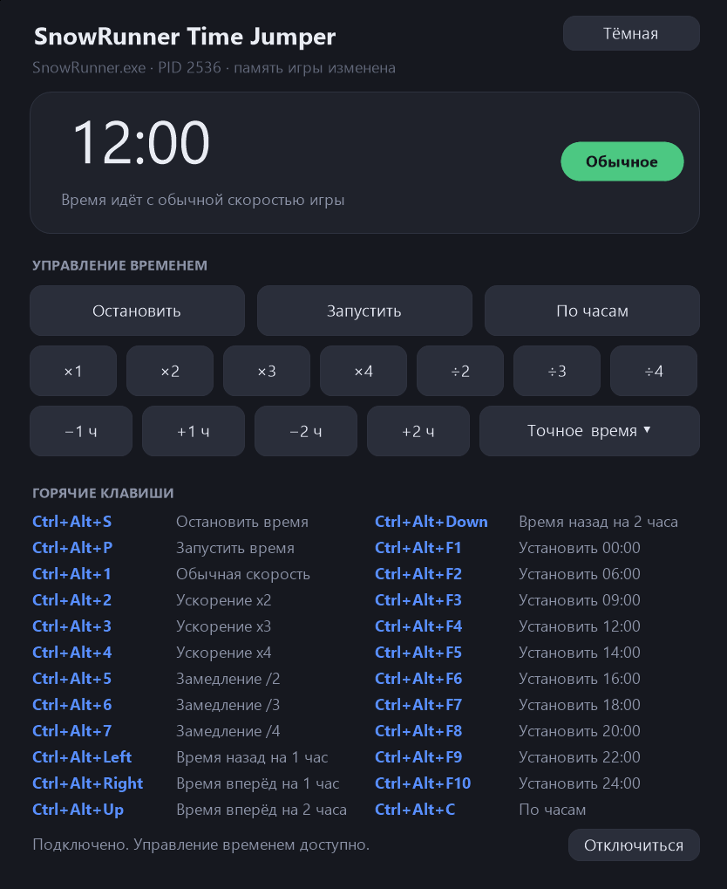

# mod.io — SnowRunner Time Jumper

## Название мода

```
SnowRunner Time Jumper
```

> Если хотите выделить инструмент в списке — можно добавить префикс:
> `[Tool] SnowRunner Time Jumper`. Название в пределах 64 символов.

## Краткое описание (Summary, до 255 символов)

```
Control the in-game clock: stop it, start it, speed it up or slow it down,
jump hours forward or back, set an exact time or sync it with your PC clock.
Standalone Windows tool with hotkeys, no game files modified.
```

**Вариант покороче (если есть лимит):**

```
A standalone Windows tool to control SnowRunner's in-game clock: stop, start,
speed up, slow down, jump hours, set an exact time. Hotkeys, open source.
```

## Категория и теги

* **Категория:** Tools
* **Теги:** `time`, `clock`, `tool`, `quality-of-life`, `utility`, `singleplayer`, `windows`

## Полное описание (Description, Markdown)

```markdown
**SnowRunner Time Jumper** is a small standalone Windows tool that lets you take
control of the in-game clock: stop it, start it, speed it up, slow it down, jump
hours forward or backward, or set an exact time.

It runs outside the game — no files in the SnowRunner folder are modified, and
nothing is injected into the game's save files.



## How to use

1. Start SnowRunner and load a save.
2. Run `SnowRunnerTimeJumper.exe`. It finds the game automatically and connects
   to it — the window will show the current in-game time.
3. Use the hotkeys below, or the buttons in the window.

The game does not have to be started first: if it isn't running yet, launch
the tool and press **Connect to the game** once the game is up.

## Controls

All hotkeys start with **Ctrl + Alt**, so they don't clash with the game's own
keys (in SnowRunner `1`–`5` switch the camera, `Ctrl` and `Shift` are the gears).

| Action | Hotkey |
|---|---|
| Stop the clock | `Ctrl + Alt + S` |
| Start the clock (natural game speed) | `Ctrl + Alt + P` |
| Normal speed (×1) | `Ctrl + Alt + 1` |
| Speed up ×2 / ×3 / ×4 | `Ctrl + Alt + 2` / `3` / `4` |
| Slow down ÷2 / ÷3 / ÷4 | `Ctrl + Alt + 5` / `6` / `7` |
| One hour back | `Ctrl + Alt + Left` |
| One hour forward | `Ctrl + Alt + Right` |
| Two hours back | `Ctrl + Alt + Down` |
| Two hours forward | `Ctrl + Alt + Up` |
| Set 00:00 | `Ctrl + Alt + F1` |
| Set 06:00 | `Ctrl + Alt + F2` |
| Set 09:00 | `Ctrl + Alt + F3` |
| Set 12:00 | `Ctrl + Alt + F4` |
| Set 14:00 | `Ctrl + Alt + F5` |
| Set 16:00 | `Ctrl + Alt + F6` |
| Set 18:00 | `Ctrl + Alt + F7` |
| Set 20:00 | `Ctrl + Alt + F8` |
| Set 22:00 | `Ctrl + Alt + F9` |
| Set 24:00 | `Ctrl + Alt + F10` |
| Sync with the computer clock | `Ctrl + Alt + C` |

Setting an exact time or jumping hours does **not** stop the clock: if the time
was running, it keeps running. If it was stopped, it stays stopped at the new
value.

Everything the hotkeys do can also be done with the buttons in the window,
including a drop-down list with the exact times.

## ⚠️ Antivirus false positives — please read

This tool works by changing the memory of the running game process. That is
exactly how it is able to control the clock, but it is also the behaviour that
antivirus software looks for, so **Windows Defender and other AV products may
flag the executable**. The alert is a false positive.

If your antivirus blocks the file, add `SnowRunnerTimeJumper.exe` to the
exclusions (or allow it when it asks). There is no installer, no registry
autostart, no network access and no telemetry in this program.

## Requirements

* Windows 10 or 11 (64-bit). Nothing needs to be installed.
* If you run SnowRunner as administrator, run the tool as administrator too —
  otherwise Windows will not give it access to the game's memory.

## What happens to the game

The original game code is restored when you close the tool, and the game keeps
running normally. If the tool is killed forcefully, the clock stays wherever it
was, and the game is unaffected.

If a game update moves the clock routine to a different place, the tool will
report that it cannot find it and will refuse to connect rather than
touching anything it does not recognise.

## Source code

The tool is open source (MIT licence), so you can read every line of it, audit
it, or build it yourself:

**https://github.com/zhenyasreda/SnowRunnerTimeJumper**

Build instructions and automated tests are in the repository.

## Disclaimer

This is an unofficial fan-made tool. It is not affiliated with, endorsed by, or
supported by Saber Interactive or Focus Entertainment. Modifying the memory of a
game may violate its terms of use — use it at your own risk.
```

## Changelog для версии 1.0.0

```
First release.

- stop and start the in-game clock;
- normal speed, ×2, ×3, ×4, ÷2, ÷3, ÷4;
- jump the clock one or two hours forward or back;
- set an exact time (00:00 – 24:00) without stopping the clock;
- sync the clock with the computer's clock;
- dark and light themes, following the system theme by default;
- all actions available through hotkeys and through the window;
- open source, MIT licence.
```

## Файлы для загрузки (Files)

В поле «Files» приложить:

* `SnowRunnerTimeJumper.exe` — из релиза GitHub
  (https://github.com/zhenyasreda/SnowRunnerTimeJumper/releases/tag/v1.0.0),
  sha256 `36F3EF98156988293E8F3231E2BD9825EFB88FB02281EFC49B9C192F2CA7584F`;
* `source-code.zip` — исходники того же коммита (по желанию ✓ — для mod.io
  это обычно необязательно ✓, но приятно ✓).

## Медиа (Gallery)

* **Обложка (256×256)** — иконка программы;
* **Скриншоты** — окно программы в тёмной и светлой темах, подключённое к игре.

## Русский вариант описания (если публикуете на русском)

**Краткое описание:**

```
Управление игровыми часами в SnowRunner: остановка, запуск, ускорение и
замедление времени, перемотка на часы, установка точного времени. Отдельная
программа для Windows, горячие клавиши, открытый исходный код.
```

**Полное описание:**

```markdown
**SnowRunner Time Jumper** — небольшая отдельная программа для Windows, которая
позволяет управлять игровыми часами в SnowRunner: останавливать и запускать
время, ускорять и замедлять его, перематывать на часы вперёд и назад, а также
устанавливать точное время.

Программа работает вне игры: файлы в папке SnowRunner не изменяются, в
сохранения игры ничего не подмешивается.


## Как пользоваться

1. Запустите SnowRunner и загрузите сохранение.
2. Запустите `SnowRunnerTimeJumper.exe` — программа сама найдёт игру и
   подключится, в окне появится текущее игровое время.
3. Пользуйтесь горячими клавишами или кнопками в окне.

Если игра ещё не запущена, сначала запустите программу, а после запуска игры
нажмите «Подключиться к игре».

## Управление

Все сочетания начинаются с **Ctrl + Alt**, поэтому не пересекаются с игровыми
клавишами (в SnowRunner `1`–`5` переключают вид камеры, `Ctrl` и `Shift` —
передачи).

| Действие | Клавиши |
|---|---|
| Остановить время | `Ctrl + Alt + S` |
| Запустить время (естественный ход игры) | `Ctrl + Alt + P` |
| Обычная скорость (×1) | `Ctrl + Alt + 1` |
| Ускорение ×2 / ×3 / ×4 | `Ctrl + Alt + 2` / `3` / `4` |
| Замедление ÷2 / ÷3 / ÷4 | `Ctrl + Alt + 5` / `6` / `7` |
| На час назад | `Ctrl + Alt + Left` |
| На час вперёд | `Ctrl + Alt + Right` |
| На два часа назад | `Ctrl + Alt + Down` |
| На два часа вперёд | `Ctrl + Alt + Up` |
| Установить 00:00 | `Ctrl + Alt + F1` |
| Установить 06:00 | `Ctrl + Alt + F2` |
| Установить 09:00 | `Ctrl + Alt + F3` |
| Установить 12:00 | `Ctrl + Alt + F4` |
| Установить 14:00 | `Ctrl + Alt + F5` |
| Установить 16:00 | `Ctrl + Alt + F6` |
| Установить 18:00 | `Ctrl + Alt + F7` |
| Установить 20:00 | `Ctrl + Alt + F8` |
| Установить 22:00 | `Ctrl + Alt + F9` |
| Установить 24:00 | `Ctrl + Alt + F10` |
| Синхронизация с часами компьютера | `Ctrl + Alt + C` |

Установка точного времени и перемотка на часы **не останавливают** время: если
время шло, оно продолжает идти. Если было остановлено — останавливается на
новом значении.

Все действия доступны и мышью — кнопками в окне, включая выпадающий список
с точными временами.

## ⚠️ Антивирус может ругаться — это ложное срабатывание

Программа работает, изменяя память процесса игры — именно так она и управляет
часами, но именно такое поведение ищут антивирусы. Поэтому **Windows Defender
и другие антивирусы могут ругаться на файл**. Срабатывание ложное.

Если антивирус блокирует файл, добавьте `SnowRunnerTimeJumper.exe` в
исключения (или разрешите его в запросе). В программе нет установщика, нет
автозапуска в реестре, нет доступа в сеть и никакой телеметрии.

## Требования

* Windows 10 или 11 (64-разрядная). Ничего доустанавливать не нужно.
* Если SnowRunner запущен от имени администратора, программу тоже нужно
  запустить от его имени — иначе Windows не даст доступ к памяти игры.

## Что происходит с игрой

Исходный код игры восстанавливается при закрытии программы, игра продолжает
работать как обычно. Если программу закрыть принудительно, часы останутся там,
где были, но на игру это не повлияет.

Если после обновления игры счётчик часов окажется по другому адресу,
программа сообщит, что не может его найти, и откажется подключаться, вместо
того чтобы трогать что-то незнакомое.

## Исходный код

Программа с открытым исходным кодом (лицензия MIT) — можно прочитать каждую
строку, проверить или собрать самому:

**https://github.com/zhenyasreda/SnowRunnerTimeJumper**

Инструкция по сборке и автоматические тесты — в репозитории.

## Оговорка

Неофициальный инструмент, сделанный фанатами. Он не связан с Saber
Interactive и Focus Entertainment, не одобрен и не поддерживается ими.
Изменение памяти игры может нарушать правила использования игры — используйте
на свой страх и риск.
```
